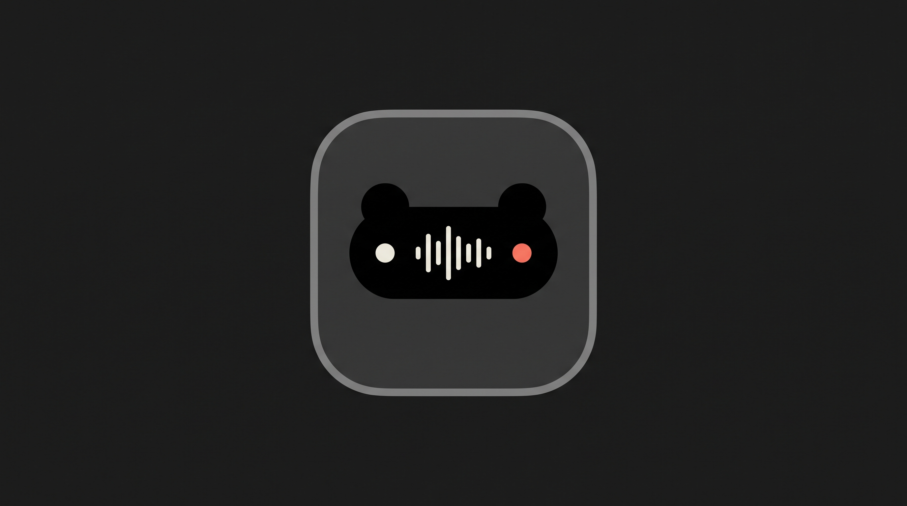

# KumaNotch 🐻🏝️

> A fluid, ultra-lightweight Apple-style **Dynamic Island** for Windows. Built for smooth multitasking without lagging potato laptops.

[](https://github.com/Fancynest/KumaNotch/releases)
[](LICENSE)
[-0078D6.svg)](#system-requirements)
[](#-privasi--100-offline)

<p align="center">
  
</p>

---

## 💻 Persyaratan Sistem
<a id="system-requirements"></a>

- **Sistem Operasi**: Windows 11 (64-bit, teruji penuh & direkomendasikan). *Catatan: Windows 10 belum diverifikasi secara resmi.*
- **Runtime**: Microsoft Edge WebView2 (terpasang bawaan di Windows 11).
- **Arsitektur**: x64 (AMD64 / Intel 64-bit).

---

## 📥 Download (Rilis v0.1.0)

Unduh versi rilis terbaru langsung dari [**GitHub Releases**](https://github.com/Fancynest/KumaNotch/releases/latest):

| Tipe File | Deskripsi | Tautan |
|---|---|---|
| **`KumaNotch_0.1.0_x64-setup.exe`** | **Installer Resmi (Disarankan)** — Setup NSIS otomatis dengan uninstaller dan shortcut start menu | [Unduh .exe](https://github.com/Fancynest/KumaNotch/releases/latest) |
| **`KumaNotch_0.1.0_x64_en-US.msi`** | Paket Windows Installer standar untuk deployment perusahaan atau instalasi terkelola | [Unduh .msi](https://github.com/Fancynest/KumaNotch/releases/latest) |
| **`kuma.exe`** | Biner CLI mandiri — otomatis disertakan di dalam installer di atas (bisa ditambahkan ke PATH lewat Settings KumaNotch) atau diunduh terpisah | [Unduh kuma.exe](https://github.com/Fancynest/KumaNotch/releases/latest) |

---

## 🛡️ Panduan Windows SmartScreen

Karena KumaNotch merupakan software open source independen yang belum memiliki sertifikat berbayar (*EV Code Signing*), Windows Defender SmartScreen mungkin menampilkan layar biru pemberitahuan saat pertama kali dijalankan:

1. Pada jendela **"Windows protected your PC"** (*Windows melindungi PC Anda*), klik **"More info"** (*Informasi selengkapnya*).
2. Klik tombol **"Run anyway"** (*Tetap jalankan*).
3. KumaNotch akan langsung aktif di bagian atas layar desktop Anda.

---

## 🌐 Catatan Microsoft Edge WebView2

KumaNotch dibangun dengan framework **Tauri 2** yang menggunakan runtime sistem Microsoft Edge WebView2:
- **Windows 11**: Sudah terpasang secara bawaan di seluruh edisi Windows 11.
- **Windows 10 (20H2+)**: Secara otomatis sudah terpasang melalui Windows Update bulanan.
- Jika Anda menggunakan instalasi Windows khusus (seperti Windows 10 LTSC atau edisi Tiny) dan belum memiliki WebView2, Anda dapat mengunduhnya secara gratis via [Microsoft WebView2 Evergreen Runtime](https://developer.microsoft.com/en-us/microsoft-edge/webview2/).

---

## 🔒 Privasi & 100% Offline

- **Zero Telemetry / Tanpa Pelacakan**: KumaNotch tidak memiliki analitik, pelacakan data, pengenal perangkat, maupun koneksi internet luar.
- **100% Berjalan Lokal**: Seluruh pemantauan media Spotify/browser (Windows SMTC), koneksi perangkat audio Bluetooth, berkas baru (*Fresh File*), dan timer Pomodoro diolah sepenuhnya di mesin Anda.
- **Keamanan IPC Terisolasi**: Daemon IPC antarmuka menggunakan Windows Named Pipe (`\\.\pipe\kumanotch`) yang dibatasi oleh kernel Windows DACL (*Discretionary Access Control List*) khusus untuk SID pengguna aktif Anda. Koneksi dari pengguna lain, guest, maupun jaringan remote secara ketat ditolak di level kernel.

---

## ✨ Fitur Utama

- **Estetika Dynamic Island**: Desain kapsul hitam pekat berlekuk squircle halus dengan bayangan lembut dan fisika spring autentik iOS (stiffness: 420, damping: 32).
- **Split Island Multitasking**: Ketika beberapa aktivitas berjalan bersamaan (misal Musik + Timer Pomodoro), pulau terbelah rapi menjadi kapsul terpisah tanpa tumpang tindih.
- **Horizontal 3-Page Home Pager**:
  - **Halaman 0 (Pemutar Musik)**: Integrasi Windows SMTC untuk Spotify, browser, dan pemutar musik lokal dengan kontrol lengkap, bilah durasi lagu, dan sampul album dinamis.
  - **Halaman 1 (Jam & Timer Cepat)**: Jam real-time format 12j/24j, tombol cepat timer (5m, 15m, 25m, Focus Session Pomodoro), custom durasi picker, dan pintasan Mode A Process Watcher.
  - **Halaman 2 (File Shelf)**: Rak berkas sementara untuk drop file/folder. Tarik langsung keluar ke Explorer, Slack, Discord, atau browser.
- **Mata Kuma ("Personality")**:
  - Animasi mata beruang Kuma yang hidup, berkedip berkala (interval acak 3–6s), berekspresi senang, fokus, sedih, penasaran, dan kaget.
  - Pupil mata mengikuti posisi kursor pengguna saat berada di dalam pulau (in-window cursor tracking).
  - Mode perayaan Artis Favorit: atur artis favorit di Settings dan nikmati animasi riang Mata Kuma saat lagunya diputar.
- **Dapat Digeser & Magnet ke Tengah**:
  - Geser pulau ke kiri atau kanan sesuai keinginan untuk menghindari webcam atau tab browser.
  - Dilengkapi radius magnetik (85px): saat digeser mendekati tengah, KumaNotch akan tertarik ke tengah layar dengan reaksi kaget (*surprised*).
- **Auto-Droplet Mode**:
  - Otomatis menciut menjadi tetesan (*droplet*) mungil saat aplikasi lain aktif agar tidak mengganggu layar kerja.
  - Cukup dekatkan kursor (dwell 2 detik) atau klik untuk mengembang kembali.

---

## ⚡ Kuma CLI (`kuma.exe`) & Process Watcher

KumaNotch dilengkapi biner CLI Rust mandiri `kuma.exe` tanpa dependensi eksternal, berkomunikasi langsung dengan pulau KumaNotch via Windows Named Pipe (`\\.\pipe\kumanotch`).

### 1. Menambahkan ke PATH
Buka KumaNotch **Settings** → tab **General**, lalu pada opsi **"Tambahkan kuma ke PATH"** klik **Tambah** dan konfirmasi. Folder instalasi `kuma.exe` akan didaftarkan ke variabel lingkungan PATH pengguna Anda (`HKCU\Environment\Path`) secara aman dengan mempertahankan tipe `REG_EXPAND_SZ`. Buka terminal baru untuk langsung menggunakannya.

### 2. Panduan Penggunaan CLI

```powershell
# Jalankan perintah terminal, teruskan stdio secara langsung, dan beri notifikasi saat selesai
kuma run cargo build --release
kuma run npm run build

# Mode A: Pantau proses yang sudah berjalan berdasarkan PID (0% CPU, kernel-driven wait)
kuma watch 12480 "Training AI Model"

# Aksi otomatis setelah selesai: sleep, lock, atau shutdown
kuma run --post-action sleep python heavy_training.py
kuma run --post-action lock ffmpeg -i movie.mkv -c:v libx265 output.mp4

# Tampilkan kartu notifikasi instan di KumaNotch
kuma notify "Backup Database Selesai" "Semua berkas tersimpan di NAS"
kuma notify "Build Gagal" --error

# Periksa apakah daemon KumaNotch aktif
kuma status
```

### 3. Keamanan Aksi Setelah Selesai (Post-Action Safety)
- Aksi sleep/lock/shutdown hanya dieksekusi bila proses berhasil dengan sukses (exit code 0).
- Muncul hitungan mundur 30 detik di pulau dengan tombol **Batal**.
- Anda dapat membatalkan aksi kapan saja langsung dari pulau maupun halaman utama Home, bahkan jika kartu notifikasi sudah ditutup.

---

## 🎮 Pintasan & Gestur

| Aksi | Gestur / Pintasan |
|---|---|
| **Buka Halaman Utama** | Klik kapsul saat idle |
| **Pindah Halaman (Musik / Jam / Shelf)** | Scroll roda mouse atau geser (*swipe*) horizontal |
| **Geser Posisi Pulau** | Klik & tahan lalu geser ke kiri/kanan di atas layar |
| **Kembalikan ke Tengah** | Dobel-klik kapsul atau seret ke area tengah layar |
| **Pantau Proses (Mode A)** | Klik ikon Terminal di bilah atas Home |
| **Buka Pengaturan** | Klik ikon roda gigi di Home, atau klik kanan ikon Tray |
| **Tutup / Perkecil** | Tekan <kbd>Escape</kbd>, klik panah bawah, atau klik di luar |
| **Buka Droplet** | Sorot kursor selama 2 detik (*dwell*), atau klik tetesan |
| **Drop Berkas ke Rak** | Tarik file/folder apa saja langsung ke atas pulau |

---

## 🛠️ Kompilasi dari Sumber (Development)

### Prasyarat
- [Node.js](https://nodejs.org/) (v18+)
- [Rust](https://www.rust-lang.org/) (stable)
- Visual Studio C++ Build Tools

```bash
# Clone repositori
git clone https://github.com/Fancynest/KumaNotch.git
cd KumaNotch

# Pasang dependensi
npm install

# Kompilasi kuma CLI lokal
npm run build:kuma

# Jalankan dalam mode dev (Vite HMR + Tauri)
npm run tauri dev

# Kompilasi installer produksi (.exe & .msi)
npm run tauri build
```

---

## 📄 Lisensi

Didistribusikan di bawah lisensi MIT. Hak Cipta © 2026 Fancynest.

